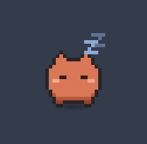
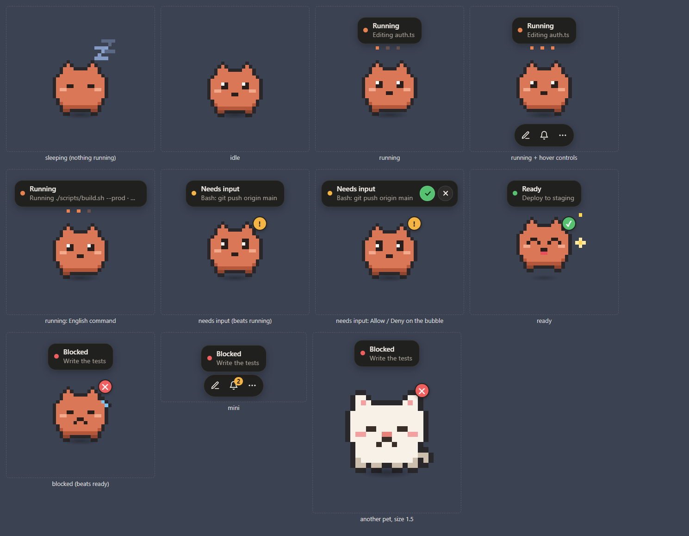

# Nibble

**A desktop pet for Claude Code.** It floats over your other windows, shows what your Claude Code sessions are doing, and tells you when one of them needs you.

<p align="center"></p>

[עברית](README.he.md)

> Nibble is a community project. It is not made by, endorsed by, or affiliated with Anthropic. It was inspired by the pets in the ChatGPT desktop app.

## What it does

- **Shows one status for all your sessions**, in the terminal and in the Claude desktop app: running, needs input, ready, or blocked. A bubble above the pet says what Claude is doing right now ("Editing auth.ts").
- **Lets you answer a permission request from the pet.** When Claude asks to run something, Allow and Deny appear on the bubble. Answering in Claude itself still works; whichever comes first counts.
- **Quick Chat.** Ask Claude Code a question from anywhere (`Ctrl + Alt + P`) without opening a window. The answer comes back to the pet.
- **An activity list** of your sessions, with the last prompt and the answer.
- **`/pet`** in any Claude Code session turns the pet on or off. It costs no tokens.
- **Opens and closes with Claude.** While it is on, the pet appears when a Claude Code session starts and leaves a few seconds after the last one is gone. It does not start with Windows.
- **Your own pets.** Four are built in. Describe a new one ("a purple dragon") and Claude draws it, or import one someone shared.
- English and Hebrew (right-to-left), following your system language. Other languages are one JSON file away.
- Optional sound and Windows notification when a session needs you, finishes or fails. Both are off by default.



## Requirements

- Windows 10 or 11. macOS and Linux are not supported yet (see [Limitations](#limitations)).
- [Claude Code](https://claude.com/claude-code), a recent version. Nibble was tested with 2.1.292; much older versions lack some of the hooks it uses.

## Install

1. Download `Nibble-Setup-x.y.z.exe` from the [latest release](../../releases/latest) and run it.
2. Click the pet, then **Connect**.

The installer is not code-signed, so Windows SmartScreen shows "Windows protected your PC" the first time. Choose **More info**, then **Run anyway**. If you would rather not, run it from source instead (below); it is the same code.

Nothing else needs installing. The app brings its own copy of Node.js for the small scripts that Claude Code runs.

### From source

Needs [Node.js](https://nodejs.org/) 22 or later.

```bash
npm install
```

```bash
npm start
```

On Windows you can also double-click `Nibble.cmd`.

## Using it

| You do | What happens |
| --- | --- |
| Click the pet | Opens the panel: Quick Chat on top, your sessions below. |
| Drag the pet | Moves it. The place is remembered. |
| Hover over it | Shows three buttons: Quick Chat, activity, menu. |
| Right-click it | Menu: change pet, settings, turn the pet off. |
| Click the bubble | Opens the session the bubble is about. |
| `Ctrl + Alt + P` | Quick Chat from anywhere. The shortcut can be changed in the settings. |

### Statuses

| Status | Meaning |
| --- | --- |
| Running | A session is working. The bubble says on what. |
| Needs input | Claude is waiting for a permission, an answer, or a decision. |
| Ready | A session finished and you have not looked at the result yet. |
| Blocked | A session failed or hit an API error. |

With several sessions the pet shows the most urgent one: needs input, then blocked, then ready, then running. After ten quiet minutes it falls asleep.

### Answering permission requests

When a session asks for a permission, the bubble gets two buttons, Allow and Deny. The same buttons are in the session's page in the panel.

By default this works for sessions in the Claude desktop app and for Quick Chats, where it was tested: Claude's own prompt stays open next to the pet's, and the first answer wins. Sessions in a plain terminal are left alone unless you add `"approvalsEverywhere": true` to `~/.nibble-pet/config.json`; that combination is untested, so treat it as an experiment. The whole feature can be switched off in the settings.

### Quick Chat

Type a question and press Enter. By default it runs in the background (`claude -p`) and the answer appears in the panel, where you can reply or continue in a terminal. If Claude needs a permission, the pet asks you. In the settings you can make Quick Chat open a terminal instead.

Without a folder, a Quick Chat runs in an empty one (`~/.nibble-pet/quick-chat`). Pick a project folder from the list next to the send button.

### `/pet`

After connecting, type `/pet` in any Claude Code session. If the pet is on, it turns off: the app closes and stays closed. If it is off, it turns on.

A Claude Code hook answers the command before it reaches the model, which is why it is free, and also why the reply appears under the heading "UserPromptExpansion operation blocked by hook". That is not an error; it is how Claude Code shows a command that a hook handled.

### Pets

Ember, Mochi, Byte and Boo are built in, and "Mini" shows only the buttons.

- **Hatch one:** in the settings, describe it and press Hatch. Claude draws it in pixels. `/hatch-pet a purple dragon` in a Claude Code session does the same.
- **Share one:** a pet is a single small JSON file. Export this pet… saves it, Import pet… loads one.

The pet respects the Windows "reduce motion" setting: each state becomes one still picture.

## How it connects to Claude Code

Even without connecting, the pet sees whether a session is busy, waiting or finished, by reading the list of running sessions that Claude Code keeps in `~/.claude/sessions`.

**Connect** adds [hooks](https://code.claude.com/docs/en/hooks) to `~/.claude/settings.json`. With them the pet also knows what Claude is doing, can show its answer, notices failures, and can offer Allow and Deny.

- The file is copied to `~/.nibble-pet/backups` before every change.
- Only entries that run Nibble's own two scripts are added. Everything else in the file is left as it was.
- **Disconnect** removes exactly those entries, and uninstalling the app does the same.
- Two slash commands are added to `~/.claude/skills`: `/pet` and `/hatch-pet`.

The hooks used: `SessionStart`, `UserPromptSubmit`, `PreToolUse`, `PostToolUse`, `PostToolUseFailure`, `PermissionRequest`, `Notification`, `ElicitationResult`, `Stop`, `StopFailure`, `SessionEnd`, and `UserPromptExpansion` for `/pet`.

## Privacy

Everything stays on your computer. Nibble has no telemetry, no account, and no update check, and it never sends anything over the network. (A Quick Chat runs your own Claude Code, which talks to Anthropic as it always does.)

What the hook writes, one line per event, to `~/.nibble-pet/events/<session>.jsonl`:

- the time, the kind of event, the session's id, its working folder, and whether it runs in a terminal or the desktop app;
- the session's title and the first 400 characters of each prompt;
- for each tool call, the tool's name and a short label: a command's description or its first 100 characters, a file's name without its folder, a search pattern, a website's host name;
- Claude's final message of each turn, up to 4,000 characters;
- notification and error messages.

A session's log is deleted a week after its last event. In the settings:

- **Keep the text of prompts and answers**: turn it off and only the kinds of events are recorded, none of the text above. The pet still shows statuses, but not what Claude is doing or what it answered.
- **Clear history**: deletes all the logs now.

Where things live:

| Path | What |
| --- | --- |
| `~/.nibble-pet/config.json` | Your preferences. |
| `~/.nibble-pet/events/` | The session logs described above. |
| `~/.nibble-pet/pets/` | Pets you hatched or imported. |
| `~/.nibble-pet/backups/` | Copies of `settings.json` from before each change. |
| `~/.nibble-pet/hook.js`, `pet.js` | The two scripts Claude Code runs. |
| `~/.claude/skills/pet`, `hatch-pet` | The two slash commands. |

## Uninstall

Remove Nibble from Windows Settings, Apps. That also takes the hooks and the slash commands out of Claude Code. Your data stays in `~/.nibble-pet`; delete that folder if you do not want it.

Running from source: press Disconnect in the settings, turn the pet off, and delete both folders.

## Limitations

- **Windows only for now.** The code avoids Windows-only APIs where it can, but the window behaviour, starting the app and the installer have only been built and tested on Windows.
- **The session list is not a public interface.** Claude Code does not document `~/.claude/sessions`, so a future version may change it. Nibble treats everything in it as optional, and with the hooks connected it does not depend on it for the essentials. Hooks are a documented, stable interface.
- **The installer is not signed**, which is what the SmartScreen warning is about.
- **Not for locked-down machines.** If your organisation manages Claude Code's settings and does not allow user hooks, Connect has no effect.
- Sessions that run on another machine (Claude Code on the web, remote sessions) are not shown.

## Building the installer

```bash
npm run build
```

Builds the installer into `dist/`. If `makensis` complains that it "could not open file", the project folder's path is too long for it; build from a shorter path.

See [CONTRIBUTING.md](CONTRIBUTING.md) for how to add a pet or a translation.

## License

[MIT](LICENSE). The installed app also contains Electron and Node.js; see [THIRD-PARTY-NOTICES.md](THIRD-PARTY-NOTICES.md).
